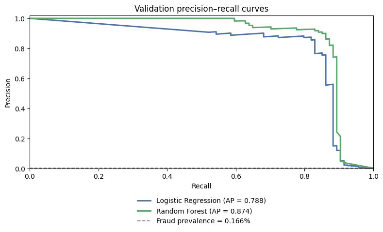
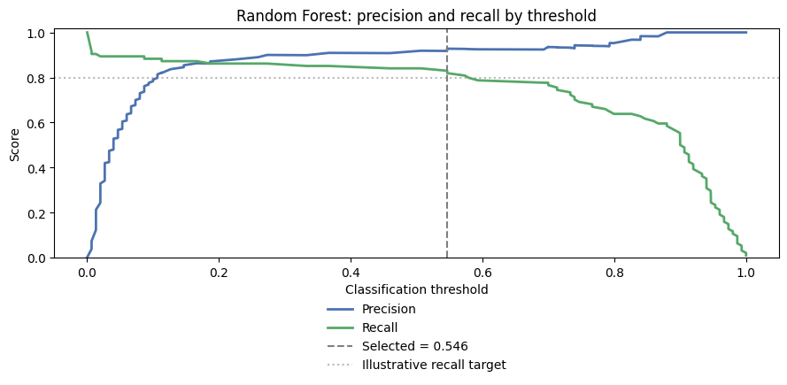
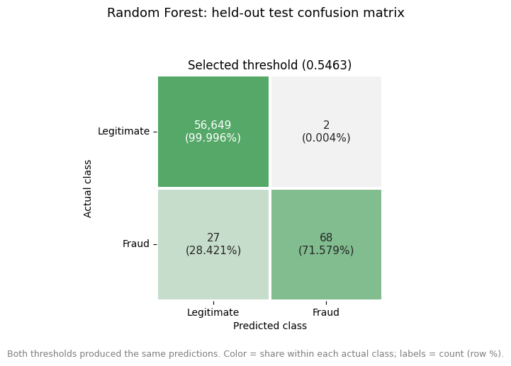
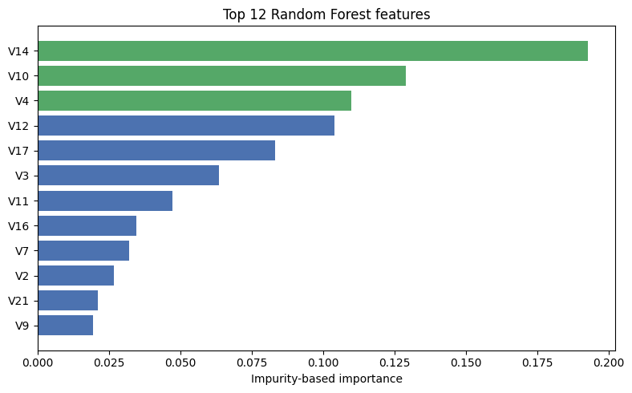

# Credit Card Fraud Detection with Random Forest

**A learning project about what happens when fraud is rare — and why accuracy alone is misleading.**

An always-legitimate classifier would reach roughly **99.83% accuracy** on the original ULB dataset while catching no fraud. I compared a Logistic Regression baseline and a Random Forest, then used the validation set to explore a decision threshold. The held-out test set illustrates the trade-off: **68 of 95 fraud cases detected, 27 missed, and 2 false alerts**.

> **Scope:** Educational portfolio analysis of historical, anonymized transactions. This is **not** a production fraud detection system or a claim about future performance. Metrics below are from the notebook's **saved run**. A later re-execution on the full CSV reproduced the headline results exactly (68 of 95 caught, 27 missed, 2 false alerts, threshold ≈0.5463); secondary decimals can vary slightly with library versions.

## At a glance

| Item | Details |
|---|---|
| Dataset | [ULB / Worldline credit card fraud data on Kaggle](https://www.kaggle.com/datasets/mlg-ulb/creditcardfraud) |
| Original dataset | 284,807 transactions; 492 fraud cases (about 0.173%; Kaggle's description rounds to 0.172%) |
| Analysis dataset | 283,726 rows after removing 1,081 exact duplicate rows, including 19 fraud rows |
| Models | Logistic Regression (baseline) and Random Forest |
| Data split | Stratified train / validation / test, approximately 60% / 20% / 20% |
| Model comparison | Average precision (AP), precision–recall curves, ROC-AUC, precision, recall, F1 |
| Threshold | Selected on validation data only, using an *illustrative* 80% fraud-recall goal |
| Notebook | [`notebooks/credit_card_fraud_detection_random_forest.ipynb`](notebooks/credit_card_fraud_detection_random_forest.ipynb) |

## Results from the saved run

### Validation: comparison at the default 0.5 threshold

| Metric | Logistic Regression | Random Forest |
|---|---:|---:|
| Average precision (AP) | 0.7876 | **0.8742** |
| ROC-AUC | **0.9790** | 0.9554 |
| Precision | 0.0538 | **0.9186** |
| Recall | **0.9043** | 0.8404 |
| Fraud caught (of 94) | 85 | 79 |
| False alerts | 1,495 | 7 |

The default **0.5** threshold is **not an equivalent operating point** between these models because their class weights and score distributions differ. I therefore use AP and precision–recall curves for the main ranking comparison. Alert counts describe what happened at these particular thresholds, not a controlled business-cost comparison.

### Random Forest: final held-out test

The threshold selected on validation was approximately **0.5463**. It produced the **same test classifications as 0.5** in this saved run — it did **not** improve test performance over the default threshold.

| Test measure | Result |
|---|---:|
| Average precision (AP) | **0.8149** |
| ROC-AUC | 0.9338 |
| Fraud precision | **97.1%** |
| Fraud recall | **71.6%** |
| Fraud F1 | 0.8242 |
| Fraud caught | 68 of 95 |
| Fraud missed | 27 |
| False alerts | 2 |
| Approximate 95% Wilson interval for recall | 61.8%–79.7% |

The validation-selected threshold reached **83.0% recall on validation**, but test recall was **71.6%**. The illustrative 80% target was **not met on test**. The Wilson interval describes sampling uncertainty under simplified independence assumptions; it does not account for drift, related transactions, or model-selection uncertainty.

## Figures

The images below were extracted from the notebook's **saved plot outputs**. They have not been regenerated from the raw CSV as part of this review.

### Precision–recall curves (validation)



### Precision–recall threshold trade-off (validation)



### Confusion matrix (held-out test)



Colors represent fractions within each **actual class**; annotations show counts and row percentages. In this run, both candidate thresholds generated the same test predictions.

### Feature importance (Random Forest)



These are impurity-based importances, **not causal explanations**. Five more exported plots are available in [`images/`](images/); all nine also appear in the notebook.

## Workflow

1. Verified the schema, missing values, class balance, and exact duplicates.
2. Removed 1,081 exact duplicate rows **before splitting** as a documented choice. Without transaction IDs, identical rows cannot automatically be classified as erroneous transactions; this exclusion included 19 fraud rows.
3. Created stratified train, validation, and test sets. Exploratory analyses shown in the notebook use training data.
4. Trained a standardized Logistic Regression baseline and a Random Forest in scikit-learn pipelines, fitting preprocessing only on training data.
5. Compared validation ranking and classification metrics; selected a threshold using validation predictions without inspecting test labels.
6. Applied the selected forest to the held-out test once for final reporting and calculated an approximate Wilson interval for fraud recall.

Additional methodological details: [`docs/METHODOLOGY.md`](docs/METHODOLOGY.md). Interpretation and next steps: [`docs/RESULTS_AND_LIMITATIONS.md`](docs/RESULTS_AND_LIMITATIONS.md).

## Repository structure

```text
credit-card-fraud-detection-random-forest/
├── README.md
├── requirements.txt
├── .gitignore
├── notebooks/
│   └── credit_card_fraud_detection_random_forest.ipynb
├── docs/
│   ├── METHODOLOGY.md
│   └── RESULTS_AND_LIMITATIONS.md
├── images/
│   └── 9 exported figures (.png)
└── data/
    └── .gitkeep
```

## How to run

1. Clone this repository or download its ZIP.
2. Get the original [`creditcard.csv` from the ULB Kaggle dataset page](https://www.kaggle.com/datasets/mlg-ulb/creditcardfraud). Place it at `data/creditcard.csv` (or beside the notebook). **The dataset is not included in this repository or archive.**
3. Use an appropriate Python environment (the saved notebook metadata reports **Python 3.10.9**), then install the listed dependencies:

   ```bash
   python -m pip install -r requirements.txt
   ```

4. Launch the notebook and run its cells in order:

   ```bash
   jupyter lab notebooks/credit_card_fraud_detection_random_forest.ipynb
   ```

The loader also checks `creditcard.csv` in the current directory, `data/`, `../data/`, and Kaggle input subfolders. **On Kaggle**, upload the notebook, attach the original ULB dataset with **Add Input**, and run all cells. The saved figures and outputs are historical notebook outputs, not evidence of a newly validated end-to-end run in another environment.

`requirements.txt` provides broad package version bounds, **not a lock file**. Headline results were reproduced on the full CSV with a different scikit-learn version; small differences in secondary metrics (third or fourth decimal) are expected across versions.

## Limitations and next steps

- The source covers **two days in September 2013**. A random split is not an out-of-time or external validation; the `Time` feature could capture patterns particular to this observation window.
- Removing duplicate rows excluded **19 fraud observations**; a sensitivity check retaining duplicates would be valuable.
- Random Forest hyperparameters were **not systematically tuned**. The Logistic Regression baseline was not comprehensively optimized either.
- Threshold selection used an illustrative recall goal, **not** estimated fraud losses, probability calibration, or operational review capacity.
- Precision depends on the class prevalence and review policy. The test results do **not** establish deployment readiness.

Next experiments: time-based holdout, duplicate-handling sensitivity, alert-capacity comparison, calibration and threshold stability, and stronger baseline tuning.

## Data source and credits

Original dataset: [Credit Card Fraud Detection — Machine Learning Group, Université Libre de Bruxelles / Worldline](https://www.kaggle.com/datasets/mlg-ulb/creditcardfraud). All source rights and usage conditions remain with their respective owners. No claim of dataset ownership is made here. Obtain the dataset from the original source and review its displayed licensing terms before redistribution.

The notebook cites: Dal Pozzolo, A., Caelen, O., Johnson, R. A., & Bontempi, G. (2015), *Calibrating Probability with Undersampling for Unbalanced Classification*.

**Portfolio:** [GitHub profile](https://github.com/anahitapouladi) · [Kaggle profile](https://www.kaggle.com/anahitapouladi)
