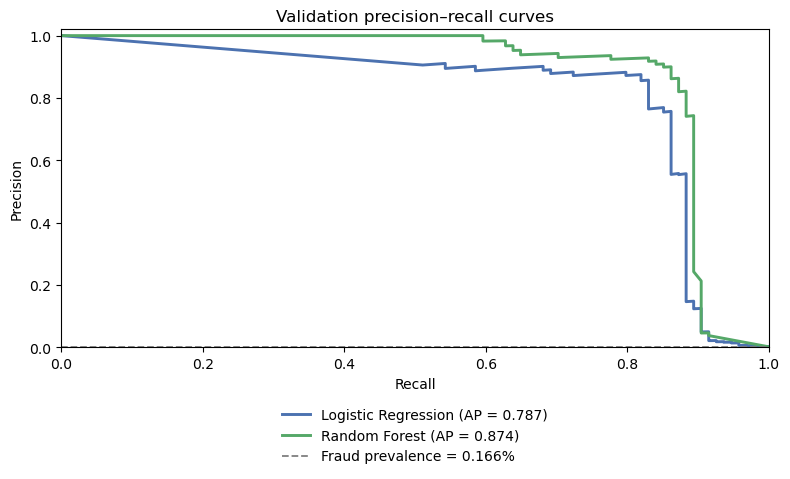
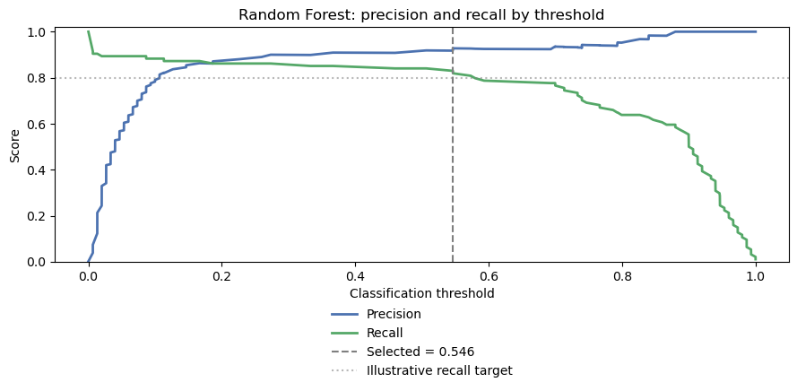
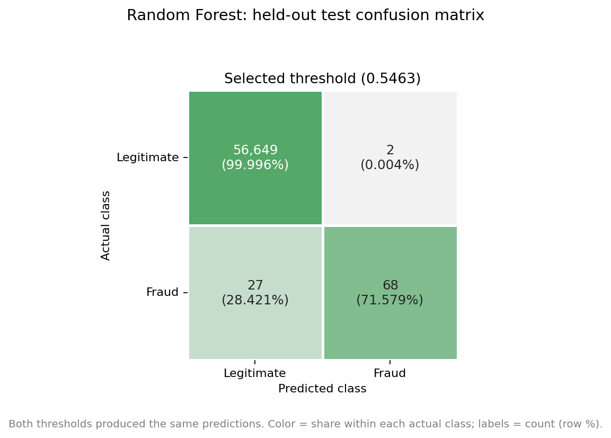
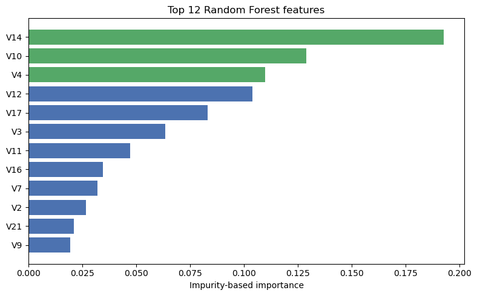

# Credit Card Fraud Detection with Random Forest

**A practical look at fraud detection when the positive class is rare.**

Can a Random Forest catch a useful share of fraudulent transactions without creating an unmanageable number of false alerts? I explored that question with the ULB credit card dataset. I compare the forest with a Logistic Regression baseline, choose an illustrative alert threshold on validation data, and report what happens on a held-out test set.

This is a **learning and portfolio project**, not a production fraud detection system.

## At a glance

| Item | Approach |
|---|---|
| Task | Binary classification: legitimate (`0`) vs. fraud (`1`) |
| Dataset | [Original ULB dataset on Kaggle](https://www.kaggle.com/datasets/mlg-ulb/creditcardfraud) · [Direct ZIP download (GitHub Release)](https://github.com/anahitapouladi/credit-card-fraud-detection-random-forest/releases/download/dataset-v1.0/creditcard.zip) |
| Models | Logistic Regression baseline; Random Forest |
| Data split | Stratified train / validation / test (approximately 60% / 20% / 20%) |
| Primary evaluation | Average precision (AP), precision, recall, F1, and confusion matrices |
| Threshold choice | Validation-only search with an illustrative 80% recall target |
| Reproducibility | Fixed random seed (`42`); preprocessing fitted on training data |

## Key results

The figures below come from the **saved run in the notebook**. They are not performance guarantees for future transactions.

### Model comparison on validation

| Metric | Logistic Regression | Random Forest |
|---|---:|---:|
| Average precision (AP) | 0.7868 | **0.8742** |
| ROC-AUC | **0.9790** | 0.9554 |
| Precision at threshold 0.5 | 0.0538 | **0.9186** |
| Recall at threshold 0.5 | **0.9043** | 0.8404 |
| Fraud cases caught (out of 94) | 85 | 79 |
| False alarms | 1,494 | 7 |

A 0.5 threshold is not a like-for-like operating point for these models: their class weights and score distributions differ. I use **AP and precision–recall curves** to compare ranking performance, and report alert counts to show what each threshold would mean in practice.

### Random Forest on the held-out test set

I selected a threshold of approximately **0.5463** using validation data only. In the saved run, the selected threshold and the default threshold of 0.5 produced the **same test predictions**.

| Test result | Value |
|---|---:|
| Average precision (AP) | 0.8149 |
| ROC-AUC | 0.9338 |
| Fraud precision | **97.1%** |
| Fraud recall | **71.6%** |
| Fraud F1 | 0.8242 |
| Fraud caught | 68 of 95 |
| Fraud missed | 27 |
| False alarms | 2 |
| Approximate 95% Wilson interval for recall | 61.8%–79.7% |

**What changed between validation and test?** Recall and AP fell, while precision rose because the model flagged only two legitimate test transactions. The illustrative 80% recall target was **not achieved** on the test set. The low number of false alarms is encouraging, but missing 27 fraud cases is still a serious limitation.

## Selected figures

The plots below are exported from the notebook's saved outputs. The confusion matrix uses row-normalized shading so the fraud cases remain visible, while the labels show actual counts.

### Validation: precision–recall curves



The forest has higher average precision on this validation split, even though Logistic Regression has higher ROC-AUC.

### Validation: threshold trade-off



The selected threshold meets the illustrative recall target on validation; it is not a business-optimized cutoff.

### Held-out test: confusion matrix



The default and validation-selected thresholds made identical test predictions in this run. The colors represent the fraction of each **actual** class; the annotations give transaction counts and row percentages.

### Random Forest feature importance



These are impurity-based importances, not causal explanations. The remaining five figures are available in [`images/`](images/), and all nine plots appear in the [notebook](notebooks/credit_card_fraud_detection_random_forest.ipynb).

## What I did

1. Checked the dataset schema, missing values, class balance, and duplicate rows.
2. Removed **1,081 exact duplicate rows** before splitting, while documenting why that choice is debatable without transaction IDs.
3. Split the data into stratified training, validation, and test sets; kept exploratory analysis on training data.
4. Explored transaction amounts, elapsed time, correlations, and IQR-based outlier patterns.
5. Trained Logistic Regression and Random Forest using scikit-learn pipelines.
6. Compared validation metrics and precision–recall curves; selected a threshold **without looking at test labels**.
7. Evaluated the selected forest once on test data, including a Wilson interval for fraud recall.

The notebook includes short explanations of **Gini impurity, bootstrap sampling, feature randomness, class weighting, precision–recall trade-offs, and statistical uncertainty** alongside the code.

## Repository layout

```text
credit-card-fraud-detection-random-forest/
├── README.md
├── .gitignore
├── requirements.txt
├── notebooks/
│   └── credit_card_fraud_detection_random_forest.ipynb
├── docs/
│   ├── METHODOLOGY.md
│   └── RESULTS_AND_LIMITATIONS.md
├── images/
│   ├── validation_precision_recall.png
│   ├── validation_threshold_tradeoff.png
│   ├── test_confusion_matrix.png
│   ├── random_forest_feature_importance.png
│   └── ... (five additional plots)
└── data/
    └── .gitkeep
```

The raw CSV is **not tracked in the Git repository**. A downloadable archive is provided separately in [GitHub Releases](https://github.com/anahitapouladi/credit-card-fraud-detection-random-forest/releases/tag/dataset-v1.0).

## Download the dataset (no Kaggle account required)

**[Download `creditcard.zip` directly (about 63.3 MB)](https://github.com/anahitapouladi/credit-card-fraud-detection-random-forest/releases/download/dataset-v1.0/creditcard.zip)**

This link downloads the dataset archive from this project's [GitHub Release (`dataset-v1.0`)](https://github.com/anahitapouladi/credit-card-fraud-detection-random-forest/releases/tag/dataset-v1.0). You do **not** need a Kaggle account to use this download.

1. Download `creditcard.zip` from the link above.
2. Extract the archive to find `creditcard.csv` and `DATASET_LICENSE.txt`.
3. Copy **`creditcard.csv`** into the project's **`data/`** folder. The final location should be `data/creditcard.csv`.
4. Keep `DATASET_LICENSE.txt` for source and license information; it is not a model input.

**Alternative:** Obtain the CSV from the [original ULB dataset listing on Kaggle](https://www.kaggle.com/datasets/mlg-ulb/creditcardfraud). The GitHub Release is a convenience copy, **not an official new version of the source dataset**. Its `dataset-v1.0` tag identifies the download package for this project.

## Run the notebook locally

**1. Get the project.** Clone this repository, or use GitHub's **Code → Download ZIP** and extract it:

```bash
git clone https://github.com/anahitapouladi/credit-card-fraud-detection-random-forest.git
cd credit-card-fraud-detection-random-forest
```

**2. Get the dataset.** Follow the [download and extraction steps above](#download-the-dataset-no-kaggle-account-required) so that `data/creditcard.csv` exists.

**3. Install the dependencies** in a Python environment:

```bash
python -m pip install -r requirements.txt
```

**4. Open the [notebook](notebooks/credit_card_fraud_detection_random_forest.ipynb)** in JupyterLab or VS Code:

```bash
jupyter lab notebooks/credit_card_fraud_detection_random_forest.ipynb
```

Run the cells in order. The loader accepts `data/creditcard.csv` from the repository root, `../data/creditcard.csv` from `notebooks/`, or a `creditcard.csv` file beside the notebook. It also searches Kaggle input folders. The original saved run used Python 3.10.9; `requirements.txt` provides compatible version ranges rather than a fully locked environment.

**On Kaggle:** Upload the notebook, attach the [ULB dataset](https://www.kaggle.com/datasets/mlg-ulb/creditcardfraud) using **Add Input**, and run all cells. Kaggle may use a different Python/library environment, so small numerical or display differences are possible.

> The notebook contains saved outputs from an earlier execution on the source dataset. Those outputs are examples; rerunning requires the CSV and can take time because the forest trains 150 trees.

## Documentation

- [Methodology and statistical concepts](docs/METHODOLOGY.md) — data handling, the models, metrics, and threshold selection.
- [Results and limitations](docs/RESULTS_AND_LIMITATIONS.md) — interpretation of the saved run, uncertainty, and next experiments.

## Limitations and next steps

This dataset covers a short historical period and uses anonymized PCA components. A random split does not measure how well the model handles **future fraud patterns**. Removing duplicate rows also removed 19 fraud observations, and the Random Forest hyperparameters were **not systematically tuned**.

If I extended the project, I would start with a chronological holdout, examine probability calibration and alert-review costs, and check threshold stability across validation samples. I would also compare against a better-tuned linear baseline.

## Data credit

The dataset comes from the **Machine Learning Group at Université Libre de Bruxelles (ULB)** in collaboration with **Worldline**. The [original dataset listing on Kaggle](https://www.kaggle.com/datasets/mlg-ulb/creditcardfraud) is the primary source for provenance and attribution.

For easier access, I provide a separate [downloadable archive in GitHub Releases](https://github.com/anahitapouladi/credit-card-fraud-detection-random-forest/releases/tag/dataset-v1.0). The archive includes `creditcard.csv` and `DATASET_LICENSE.txt`, which contains source attribution and links to license information. **The dataset is not my original work**; the data remain subject to the original providers' terms. The CSV is not committed to Git history.

**Portfolio:** 
[GitHub profile](https://github.com/anahitapouladi/credit-card-fraud-detection-random-forest)
[Kaggle notebooks profile](https://www.kaggle.com/code/anahitapouladi)
